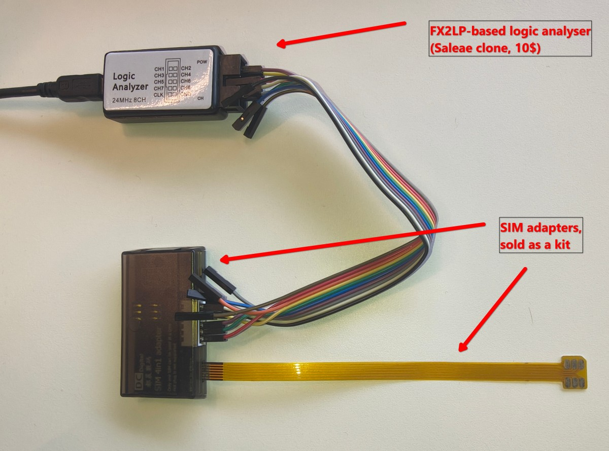
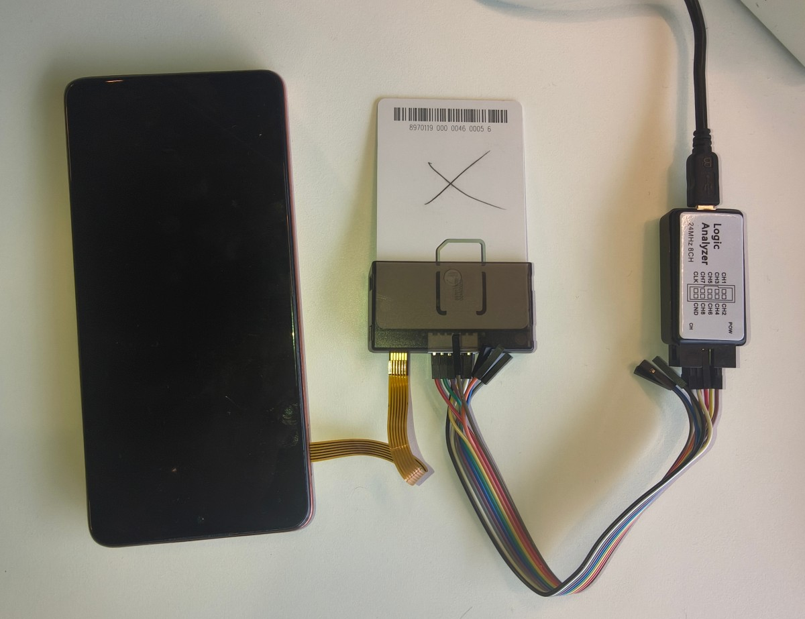
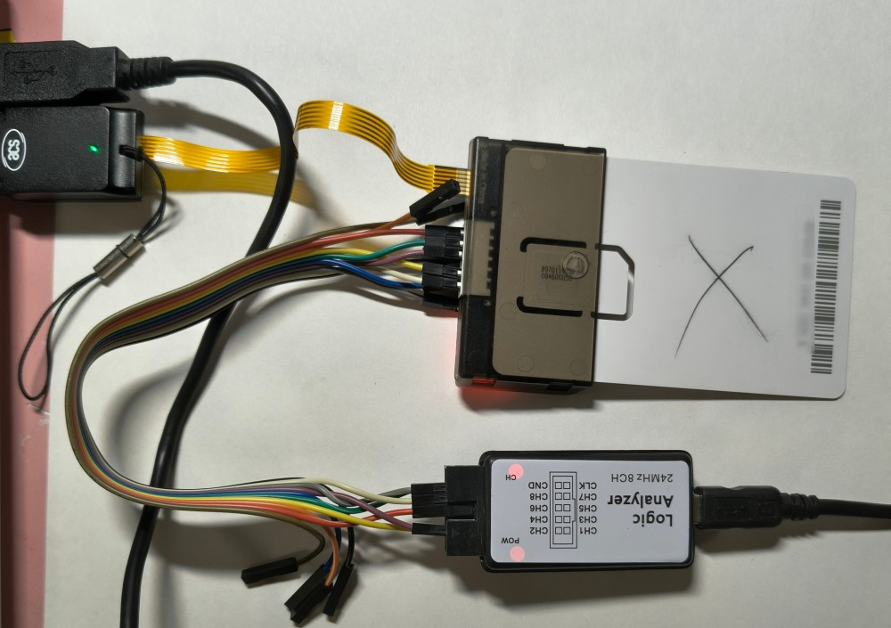
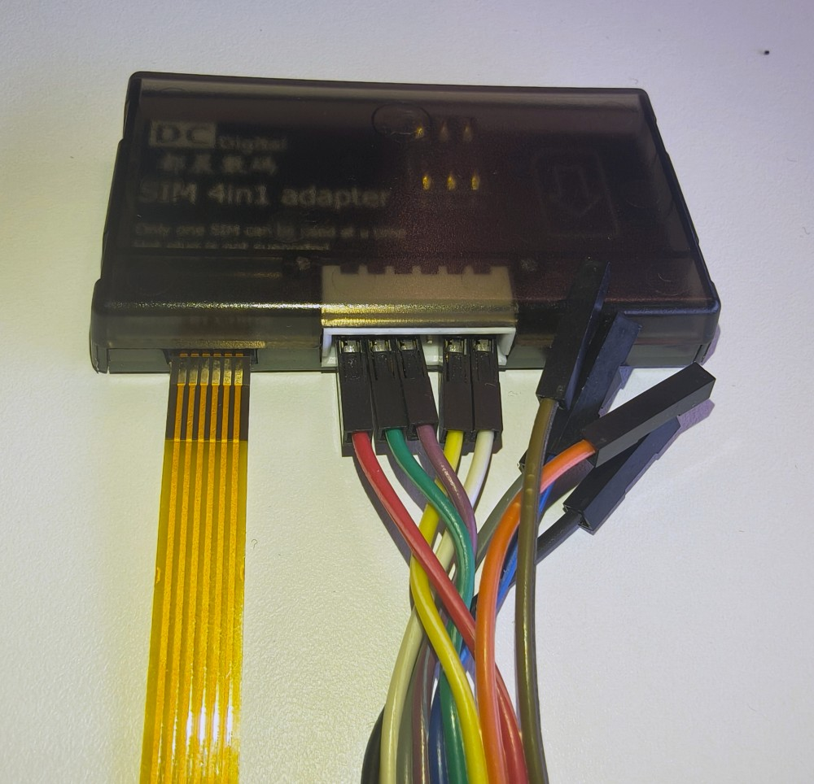
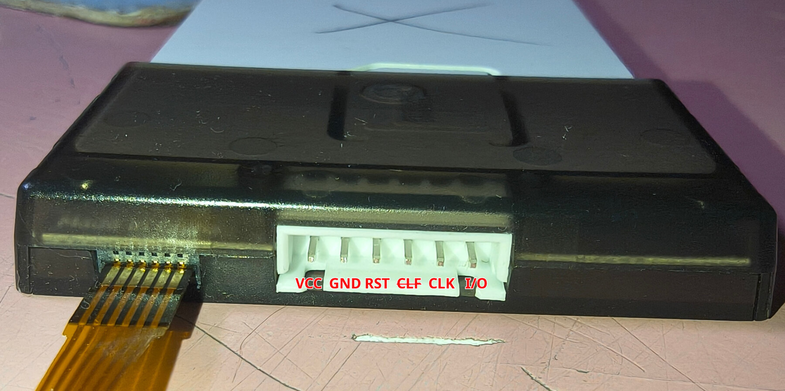
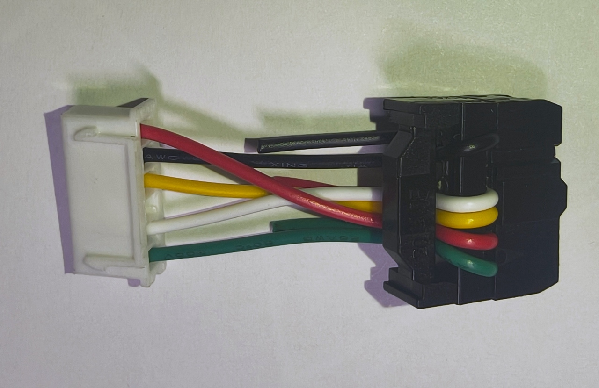
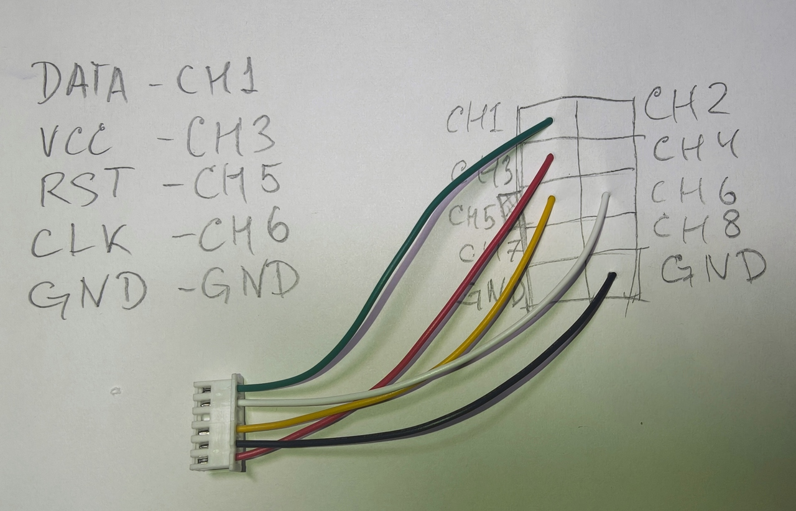
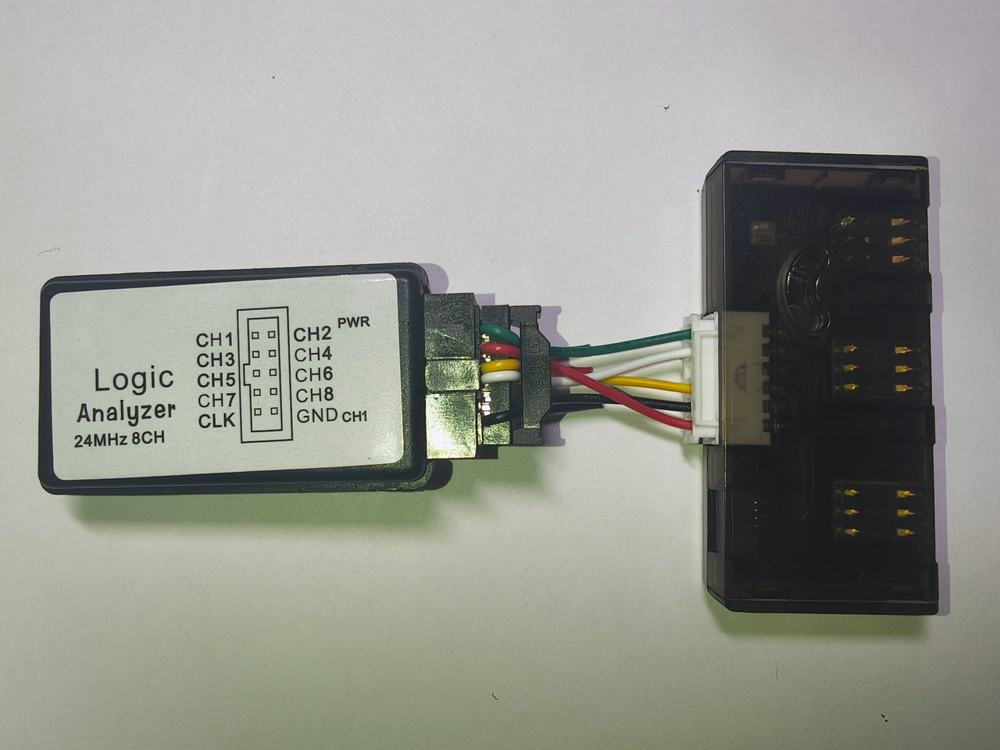
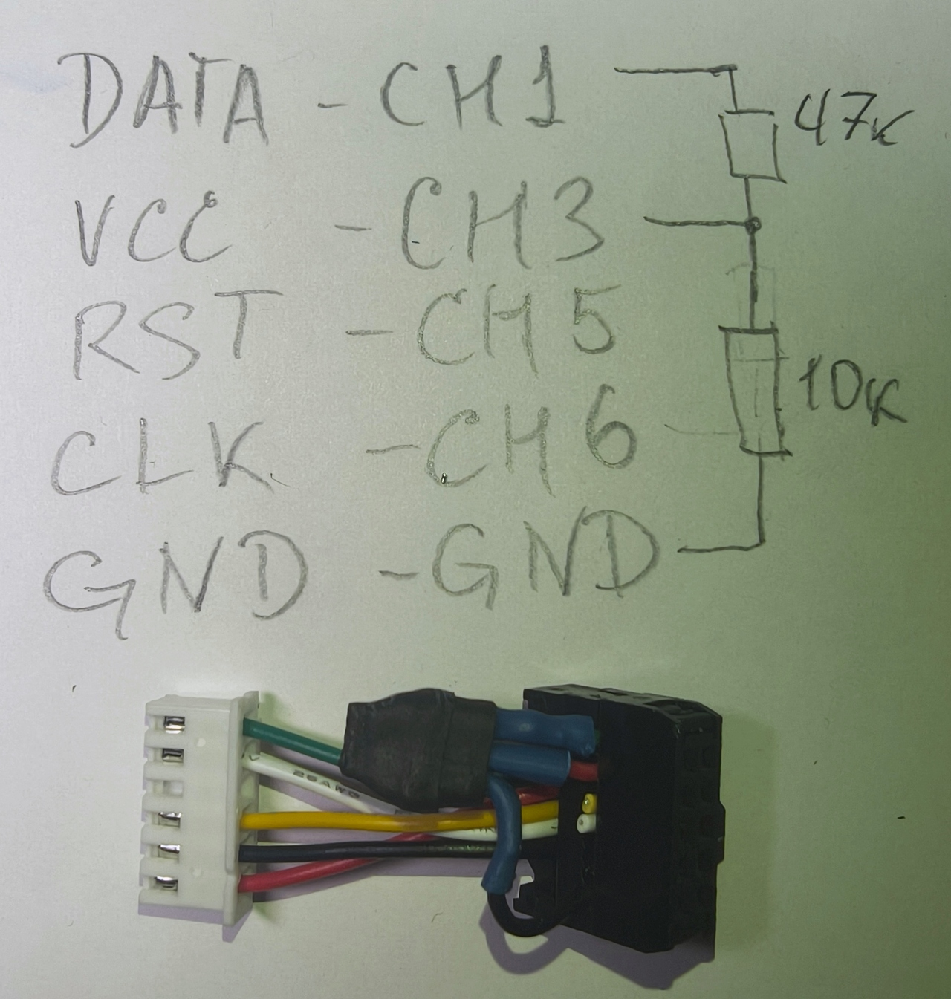

> English version: [README.md](README.md)

# sigrok_iso7816_stream

📢 Новости и обновления проекта: [Сайт](https://atroshin.ru) · [Telegram-канал](https://t.me/youeyeseesee)

Форк [svenso/sigrok_iso7816](https://github.com/svenso/sigrok_iso7816) с
**живым GSMTAP-UDP-стримингом**: дешёвый логический анализатор FX2 (клон
Saleae) ведёт себя как сниффер SIMtrace2:

```
SIM-карта ⇄ ридер (пассивный съём с контактов)
    → логический анализатор FX2 (fx2lafw, 8 каналов, до 24 МГц)
    → sigrok-cli + декодер iso7816
    → GSMTAP UDP :4729  →  [SIMtrace Analyser](https://github.com/anttro/simtrace-analyser) / Wireshark
```

[SIMtrace Analyser](https://github.com/anttro/simtrace-analyser) —
рекомендуемый инструмент для визуализации живых трасс и просмотра
сохранённых записей; он также умеет импортировать и экспортировать
GSMTAP pcap-файлы (включая PCAP, который этот декодер пишет через опцию
`pcap_file=<path>`).

## Установка и запуск

Оба способа ставят один и тот же декодер — выберите один:

- **Скачать (рекомендуется)** — архив релиза.  Не нужно ничего клонировать и
  нет истории git: распакуйте, запустите `setup`, затем `start`.  Лучший
  вариант, если нужен только съём.
- **Из исходников** — `git clone`.  Тот же рантайм плюс материал для
  разработки: `tests/` и инструменты трасс и базовой линии
  (`tools/capture_baseline.sh`, `tools/compare_baseline.sh`,
  `tools/vs_reader.py`).  Трассы примеров (`examples/`) исключены из git и
  остаются локальными.  В архивах релиза нет `tests/`, dev-инструментов и
  `examples/`.

### Скачать (рекомендуется)

Скачайте последний архив со страницы
[Releases](https://github.com/anttro/sigrok_iso7816_stream/releases/latest):

- `sigrok_iso7816_stream-<version>.tar.gz` — Linux
- `sigrok_iso7816_stream-<version>.zip` — Windows

К каждому релизу прилагается `SHA256SUMS` — в нём **оба** архива.
Положите файл рядом со скачанным архивом и проверьте:

```bash
sha256sum -c --ignore-missing SHA256SUMS   # GNU coreutils (Linux)
```

В Windows выполните `certutil -hashfile sigrok_iso7816_stream-<version>.zip SHA256`
и сравните вывод со строкой `.zip` в `SHA256SUMS`.

#### Linux (скачать)

```bash
tar xzf sigrok_iso7816_stream-<version>.tar.gz
cd sigrok_iso7816_stream-<version>
./setup.sh
./start.sh
```

`setup.sh` проверяет, что установлены sigrok-cli и пакет прошивки FX2
(`sigrok-firmware-fx2lafw`), создаёт симлинк каталога проекта в
`~/.local/share/libsigrokdecode/decoders/iso7816` (пользовательские
декодеры перекрывают системные) и опрашивает подключённое устройство на
предмет максимальной поддерживаемой частоты дискретизации.

#### Windows (скачать)

Предварительные требования:

1. **sigrok-cli** — установщик для Windows (0.7.2 x86_64) с
   [sigrok.org/wiki/Downloads](https://sigrok.org/wiki/Downloads) —
   протестированная версия.  На этой же странице публикуются ночные сборки
   для Windows; они могут менять синтаксис sigrok-cli или API декодеров,
   поэтому поддерживаемой остаётся версия из релизного установщика 0.7.2.
   Если sigrok-cli не запускается с ошибкой `0xc0150002`, установите
   [Visual C++ 2010 Redistributable](https://www.microsoft.com/en-us/download/details.aspx?id=26999)
   (`msvcr100.dll` требуется встроенному Python-рантайму).
2. Прошивка fx2lafw поставляется вместе с установщиком — отдельно скачивать не нужно.

Настройка драйвера (донглам FX2 нужен WinUSB, вендорский драйвер не подойдёт):

- Запустите **Zadig**, который лежит *внутри* каталога установки sigrok-cli
  (также доступен из меню «Пуск»). Выберите устройство FX2 в выпадающем
  списке и установите драйвер **WinUSB**.
- После загрузки прошивки устройство переподключается с другим VID/PID —
  если оно всё ещё не находится, запустите Zadig **второй раз** для
  переподключившегося устройства.
- Windows привязывает драйверы к USB-порту, когда нет серийного номера:
  перенос донгла в другой порт может потребовать повторить Zadig.

Затем распакуйте архив `.zip` (в Проводнике: правой кнопкой → «Извлечь все»)
и запустите в распакованном каталоге:

```bat
setup.bat
start.bat
```

`setup.bat` проверяет sigrok-cli и встроенную прошивку, регистрирует декодер
этого проекта через junction в
`%LOCALAPPDATA%\libsigrokdecode\decoders\iso7816` (подтверждается тем, что
`sigrok-cli -L` показывает `iso7816`), и опрашивает устройство на предмет
поддерживаемых частот дискретизации.  В zip-архиве релиза bat-файлы уже с
переводами строк CRLF, поэтому преобразование не требуется.
`start.bat --help` перечисляет его опции (основное подмножество `start.sh`:
каналы, частота дискретизации, clock, host/port, pcap, protocol, debug).

### Из исходников

#### Linux (из исходников)

```bash
git clone git@github.com:anttro/sigrok_iso7816_stream.git
cd sigrok_iso7816_stream
./setup.sh
./start.sh
```

`setup.sh` выполняет те же проверки и создаёт тот же симлинк, что и выше.

#### Windows (из исходников)

Предварительные требования Windows (sigrok-cli и Visual C++ 2010
Redistributable, встроенная прошивка fx2lafw и настройка драйвера
Zadig/WinUSB) — те же, что в разделе
[Windows (скачать)](#windows-скачать) выше.

```bat
git clone git@github.com:anttro/sigrok_iso7816_stream.git
cd sigrok_iso7816_stream
setup.bat
start.bat
```

`setup.bat` выполняет те же проверки и регистрацию junction, что и выше.
`start.bat` поддерживает основное подмножество опций; основной формат — с
пробелом, `--clk=CH` тоже работает (`start.bat --help` перечисляет опции):

```bat
start.bat --clk D1 --data D6
```

Примечание: bat-файлы требуют переводов строк CRLF; репозиторий следит за
этим через `.gitattributes`, поэтому свежий клон в Windows уже корректен
(zip-архив релиза содержит те же файлы с CRLF).

## Использование

`start.sh` пишет непрерывный поток на частоте 16 МГц до Ctrl+C (`rc=130`) и
стримит GSMTAP на 127.0.0.1:4729.  Умолчания: выводы D5=CLK, D0=I/O,
D4=RST, D2=VCC.  Переопределяются аргументами:

```bash
./start.sh --clk=D1 --data=D6          # другое подключение
./start.sh --no-rst --no-vcc           # только CLK+I/O
./start.sh --host=10.0.28.7            # стримить на удалённый анализатор
./start.sh --pcap=session.pcap         # также записать декодированные события в PCAP
./start.sh --debug                     # полный вывод декодера и sigrok (все
                                       # строки аннотаций + libsigrok -l 4);
                                       # по умолчанию показываются только
                                       # декодированные APDU и предупреждения/ошибки
```

В Windows `start.bat` принимает то же основное подмножество опций (форма с
пробелом; форма `--opt=value` тоже работает) — см. заметки по установке
Windows выше.

### Подключение

Рекомендуемый способ съёма — короткий кабель с внешними подтягивающими
резисторами (см. раздел «Съём на практике» ниже): 10 кОм к GND на VCC
(тянет вниз без питания) и 47 кОм к VCC на DATA (быстрее фронт вверх).
Его распиновка **фиксирована и известна заранее** — см. таблицу
«Распиновка» ниже — и в точности совпадает с умолчаниями `start.sh`
(`D5`=CLK, `D0`=I/O, `D4`=RST, `D2`=VCC).  Автодетект подключения не нужен;
выводы не меняются.

> **Сначала GND.** Сначала подключите GND и проверьте его вручную
> (мультиметром или заведомо исправным контактом) — отсутствующий или
> плохой контакт земли маскируется под все остальные неисправности сразу:
> плавающие линии, фантомные стартовые биты, кадры из одних нулей.

### Распиновка

Каналы клона FX2 назначаются через `-P iso7816:clk=N:data=N:rst=N:vcc=N`.
Рекомендуемый съём коротким кабелем (с внешними подтягивающими резисторами)
использует фиксированные выводы, которые в точности совпадают с умолчаниями
`start.sh`; `--clk`/`--data`/`--rst`/`--vcc` переназначают их, если вы
подключили иначе:

| Канал FX2 | Контакт SIM | Сигнал |
|-------------|-------------|--------|
| D0 | C7 | I/O |
| D2 | C1 | VCC (только цифровой уровень!) |
| D4 | C2 | RST |
| D5 | C3 | CLK |
| GND | C5 | GND |

Входной порог FX2 близок к TTL (~1.4 В): карты класса 1.8 В могут читаться
нестабильно; классы 3 В/5 В — нормально.

### Режимы CLK

- `native` (по умолчанию) — живые записи.  Декодер отслеживает переключение
  скорости по PPS и заново взводится по RST, поэтому тёплые сбросы и трафик
  после PPS разбираются корректно.
- `detect` — для офлайн-экспериментов или записей без PPS.  Он не отслеживает
  переключение по PPS, поэтому трафик после PPS может читаться неверно.
- `sample_as_clock` — экспериментальный режим upstream; для съёма SIM не
  рекомендуется.

### Решение проблем при живой записи

**Запись обрывается рано (особенно в Windows).** Частая причина —
неподходящий драйвер USB.  Драйвер Saleae Logic работает только с Saleae
Logic software; sigrok нужен драйвер **WinUSB**.  Установите его через
**Zadig** (входит в установщик sigrok-cli) и повторите назначение после
переподключения устройства с VID/PID прошивки.  Подробности в документации
sigrok:

- https://sigrok.org/wiki/Windows#Drivers
- https://sigrok.org/wiki/Fx2lafw

**Устройство не найдено / нет сигнала.** Проверьте драйвер WinUSB (Windows),
прошивку fx2lafw, подключение и GND (см. «Подключение»), попробуйте другой
USB-порт и заведомо исправный кабель.  Дешёвые USB-кабели и хабы — частая
причина остановок.

**Запись завершается сама (`rc=0`).** FX2 упирается в потолок пропускной
способности USB на высокой частоте дискретизации.  Снизьте `--samplerate`,
избегайте хабов, закройте другой USB-трафик.  `start.sh` автоматически
перезапускает запись при `rc=0` (по умолчанию 20 перезапусков с паузой 2 с;
`--no-loop`, `--max-restarts=N`, `--restart-delay=S`).  При `--pcap=FILE`
каждый перезапуск пишет `FILE.<N>.<ext>`.

`start.sh` работает до Ctrl+C; нажатия клавиш его не останавливают
(приглашение «нажмите любую клавишу» отключено).  Полезные опции:

```bash
./start.sh --pcap=s.pcap --log=s.log           # записать события и вердикт rc=
./start.sh ... --samplerate=24M                # больше запаса по таймингу при необходимости
./start.sh ... --klog                          # также записать журнал ядра
./start.sh ... --debug                         # полный вывод декодера и sigrok
```

- `--log` сохраняет строку вердикта `rc=` в конце сессии.
- Декодер пишет `SIGNAL INTEGRITY WARNING`, когда ≥ 8 из последних 64 кадров
  не проходят проверку чётности.
- Десинхронизированные пакеты сохраняются с флагом `GSMTAP_FLAG_BAD_FCS` в
  байте `res` заголовка GSMTAP — видно в Wireshark как предупреждение BAD-FCS.

### Сырые команды sigrok-cli

Эквивалентные команды без скриптов-обёрток:

```bash
# Минимум: только CLK+I/O, живой поток на localhost:4729
sigrok-cli -d fx2lafw --config samplerate=12M --continuous \
  -P iso7816:clk=D0:data=D1:clock_option=detect -A iso7816

# Полное подключение: CLK + I/O + RST + VCC с отслеживанием событий линий
sigrok-cli -d fx2lafw --config samplerate=12M --continuous \
  -P iso7816:clk=D5:data=D0:rst=D4:vcc=D2:clock_option=native:rst_detect=true:vcc_detect=true \
  -A iso7816

# Поток на удалённый анализатор / отключить стриминг / писать PCAP-файл
... -P iso7816:...:gsmtap_host=10.0.28.7 ...
... -P iso7816:...:gsmtap_enable=false ...
... -P iso7816:...:pcap_file=trace.pcap ...

# Классический режим upstream: бинарный PCAP в stdout
sigrok-cli -i capture.sr -P iso7816:clk=2:data=0 -B iso7816=pcap > out.pcap
```

## Съём на практике


*Компоненты, использованные в сборке*


*Стенд снимает сессию SIM-карты телефона*


*Стенд снимает сессию картридера*


*Переходник для съёма с SIM*


*Подключение к контактам SIM*


*Съём коротким кабелем — меньше площадь контура и артефактов фронта*


*Детали подключения короткого кабеля*


*Короткий кабель с обвязкой*


*Короткий кабель с внешними подтягивающими резисторами — 10 кОм к GND на VCC (тянет вниз, когда питания нет), 47 кОм к VCC на DATA (быстрее фронт вверх)*

## Возможности

| Возможность | Описание |
|---------|-------------|
| Живой поток GSMTAP | Каждое декодированное событие отправляется как GSMTAP-SIM UDP-пакет (включено по умолчанию, повторяет поведение simtrace2-sniff) |
| Правильные sub_types | ATR=0x01 и PPS=0x02 корректно помечаются в PCAP |
| ATR/PPS в PCAP | ATR и объединённые запрос+ответ PPS выводятся как PCAP-пакеты |
| Отслеживание RST (опционально) | `rst_detect=true`: события assert/deassert сброса (sub_type 0x10) |
| Отслеживание VCC (опционально) | `vcc_detect=true`: события включения/выключения питания (sub_type 0x11) |
| PCAP сразу в файл | `pcap_file=<path>` пишет PCAP без перенаправления вывода оболочки |
| Деглитч стартового бита | Подавляет LOW-глитчи короче ETU (2 отсчёта при 16 МГц, масштабируется от частоты дискретизации) |
| Захват ETU в середине сессии | Восстанавливает ETU по линии DATA, когда CLK непригоден; скорость, не прошедшая проверку чётности, измеряется заново |
| Защита ATR / ресинхронизации | Проверяет ATR, игнорирует неверно кадрированные кандидаты и выравнивается после десинхронизации |
| Инверсная конвенция | Поддерживает прямую (TS=0x3B) и инверсную (TS=0x3F) карты |
| Блоки T=1 | Разбирает NAD/PCB/LEN/INF/LRC с цепочкой по биту M; INF I-блока выдаётся как APDU |
| Флаг чётности | Пакеты с ошибкой чётности помечаются `GSMTAP_FLAG_BAD_FCS` |
| Пороги от частоты | Пороги деглитча, защиты и ETU масштабируются от частоты дискретизации |

## Опции декодера

| Опция | По умолчанию | Описание |
|--------|---------|-------------|
| `clock_option` | `native` | `native`, `detect`, `sample_as_clock` (см. FAQ upstream) |
| `protocol` | `auto` | `auto`, `T=0`, `T=1` |
| `gsmtap_enable` | `true` | Живой GSMTAP UDP-стриминг |
| `gsmtap_host` | `127.0.0.1` | Хост назначения GSMTAP |
| `gsmtap_port` | `4729` | Порт назначения GSMTAP |
| `pcap_file` | *(пусто)* | Писать PCAP в этот файл вдобавок к бинарному выводу |
| `rst_detect` | `false` | Отслеживать события пина RST (требуется назначенный канал `rst`) |
| `vcc_detect` | `false` | Отслеживать события пина VCC (требуется назначенный канал `vcc`) |

Каналы: `clk`, `data` (обязательные); `rst`, `vcc` (опциональные —
назначайте только если соответствующий провод физически подключён).

## События GSMTAP

Заголовок GSMTAP: версия 2, тип SIM (0x04), UDP-порт 4729.

| sub_type | Имя | Полезная нагрузка |
|----------|------|---------|
| 0x00 | APDU | сырые байты пакета T=0/T=1 |
| 0x01 | ATR | сырые байты ATR |
| 0x02 | Запрос PPS | сырые байты запроса PPS |
| 0x03 | Ответ PPS | сырые байты ответа PPS |
| 0x10 | Событие RST (кастомное) | `[direction, level, flags, clk_hz_be32]` — частота CLK добавляется, когда известна |
| 0x11 | Событие VCC (кастомное) | `[direction, level, 0x00]` |

Семантика байтов полезной нагрузки:
- RST: `direction` 1 = сброс asserted (высокий→низкий), 0 = deasserted (низкий→высокий);
  `level` = уровень линии после перехода.
- VCC: `direction` 1 = питание подано (низкий→высокий), 0 = снято (высокий→низкий);
  `level` = уровень линии после перехода.

0x00–0x03 совпадают с gsmtap.h из libosmocore: стандартные значения и
полезные нагрузки (запрос и ответ PPS отправляются отдельными пакетами).
0x10/0x11 — кастомные расширения, не определённые в gsmtap.h из
libosmocore.

События RST несут измеренную частоту CLK, когда она известна: тогда
устанавливается бит 0 байта `flags`, а следом идёт частота как big-endian
uint32 в герцах (полезная нагрузка 7 байт).  Пока частота не измерена,
нагрузка остаётся 3 байта, поэтому потребители, читающие только первые два
байта, не затрагиваются.  Вместе с F/D, согласованными в ATR/PPS, скорость
передачи данных равна `clk_hz × D / F` бит/с.

Расширения заголовка: флаги вроде `GSMTAP_FLAG_BAD_FCS` пишутся в байт
`res` заголовка, который официальный gsmtap.h помечает как зарезервированный
(RFU).  Это собственное расширение данного декодера (upstream simtrace2-sniff
никогда не заполняет `res`); семантика флагов повторяет флаги данных (data
flags) USB-протокола simtrace2 и не является частью спецификации libosmocore.

## Заметки и ограничения по детектированию RST/VCC

- События детектируются **асинхронно до первого ATR** (включение питания /
  снятие сброса фиксируются, как только уровень стабилизируется) и **на
  границах пакетов** между T=0/T=1 в дальнейшем.
- Фронты, происходящие целиком *внутри* передачи пакета, наблюдаются как
  итоговое изменение уровня на следующей границе; короткие импульсы внутри
  пакета могут быть пропущены.
- VCC — только цифровой: декодер видит «питание есть/нет», но никогда
  не класс напряжения (1.8/3/5 В).
- **RST и VCC используют гистерезис стабильности уровня 10 мс**
  (масштабируется от частоты дискретизации): новый уровень сообщается
  только после того, как он непрерывно стабилен ≥ 10 мс.  Это делает
  включение и выключение питания *симметричными* и подавляет звон и
  короткие глитчи.
- **События VCC в целом ненадёжны — лучше не отслеживать VCC.** Плавающий
  или неподключённый пин съёма VCC всегда читается как HIGH (логическая
  единица без нагрузки), поэтому декодер постоянно видит «питание подано»
  и выдаёт ложные события питания при каждом дребезге.  Если ваш съём не
  берёт VCC с чистого нагруженного источника, лучше **оставить канал `vcc`
  неназначенным** (не передавать `--vcc`) и держать `vcc_detect=false`;
  отслеживания RST обычно достаточно, чтобы видеть сбросы.  Включайте
  отслеживание VCC только на съёме с надёжным измерением VCC (и надёжным
  GND — см. заметки о подключении).
- Неназначенные опциональные каналы игнорируются, даже если
  `rst_detect`/`vcc_detect` включены (защита через `has_channel()`).

## Разработка и тестирование

Декодер проверяется на примерах записей с помощью `tools/vs_reader.py`.
Фикстуры трасс хранятся локально и не входят в репозиторий.

### Проверка по SDK ридера (`tools/vs_reader.py`)

На контролируемом стенде (PCSC-ридер под управлением софта) эталонный
журнал APDU из SDK ридера можно сравнить с декодированным PCAP:

```bash
sigrok-cli -i <trace>.sr \
  -P iso7816:clk=D5:data=D0:rst=D4:vcc=D2:clock_option=native:rst_detect=true:vcc_detect=true:gsmtap_enable=false:pcap_file=out.pcap \
  -A iso7816
python3 tools/vs_reader.py <reader-log>.log out.pcap
```

`vs_reader.py` выравнивает каждый обмен из журнала ридера с APDU из записи
(побайтовое LCS-совпадение) и классифицирует остатки как proactive/CAT
(невидимые для SDK ридера), pre-capture/потерянные или мусор.

### Записи холодного старта (запись начинается до включения питания)

Когда запись начинается до включения питания, RST всё ещё низкий на
отсчёте 0.  Используйте `rst_detect=true` и `protocol=T=0`; декодер взводит
охоту за ATR по начальному уровню RST и разбирает полный ATR.  Пример:

```bash
sigrok-cli -i <coldboot>.sr \
  -P iso7816:clk=CLK:data=DATA:rst=RST:vcc=VCC:clock_option=native:protocol=T=0:rst_detect=true:vcc_detect=true:gsmtap_enable=false:pcap_file=out.pcap \
  -A iso7816
```

### Сценарии записи: ридер (постоянный CLK) и телефон (Clock Stop Mode)

- **Запись ридера / постоянный CLK** — ридер ведёт ровный CLK всю сессию.
  Проверяйте её по SDK ридера через
  `tools/vs_reader.py <reader-log>.log out.pcap`.
- **Запись телефона / гейтированный или остановленный CLK** — телефон
  гейтирует или останавливает CLK между передачами (Clock Stop Mode),
  поэтому ETU нельзя вывести из CLK.  Запускайте с `protocol=T=0`; декодер
  восстанавливает ETU из линии DATA и декодирует edge-list читателем.
  Команды T=0 case 3/4 (например, `80 12`/`80 14` STK envelope) объединяются
  в один APDU команда→ответ.

Рекомендуемые вызовы:

```bash
# Запись ридера (контролируемый стенд, CLK всегда работает)
sigrok-cli -i <trace>.sr \
  -P iso7816:clk=CLK:data=DATA:rst=RST:vcc=VCC:clock_option=native:rst_detect=true:vcc_detect=true:gsmtap_enable=false:pcap_file=out.pcap \
  -A iso7816
python3 tools/vs_reader.py <reader-log>.log out.pcap

# Запись телефона (середина сессии, гейтированный/остановленный CLK)
sigrok-cli -i <phone>.sr \
  -P iso7816:clk=CLK:data=DATA:rst=RST:clock_option=native:rst_detect=true:vcc_detect=false:protocol=T=0:gsmtap_enable=false:pcap_file=out.pcap \
  -A iso7816
```

### Скорости данных и ETU

Справочные значения, наблюдавшиеся на примерах записей при частоте
дискретизации 16 МГц:

| Трасса | Режим CLK | ETU (отсчёты) | CLK/ETU | Конвенция | Примечания |
|-------|----------|---------------|---------|------------|-------|
| test_8 | постоянный | ~43 | 372 (стандарт) | Direct | PC/SC ридер, ATR+PPS+APDU |
| test_7 | постоянный | ~43 | 372 (стандарт) | Direct | PC/SC ридер, тёплые сбросы |
| xiaomi | гейтированный/остановленный | ~53 | восстановлен из DATA | Direct | Телефон, середина сессии |
| samsung | гейтированный/остановленный | ~72 | 16 (F=512/D=32) | Direct | Телефон, нестандартный F/D, меню STK |
| alcor_reader | постоянный | ~53 | 16 (F=512/D=32) | Direct | PC/SC ридер, CLK 4.0 МГц на ATR -> 4.8 МГц после PPS |

Декодер автоопределяет ETU и выбирает подходящий читатель битов
(CLK-синхронный для постоянного CLK, edge-list для гейтированного/
остановленного CLK).  Никакой ручной настройки не требуется, кроме
`clock_option=native` и `protocol=T=0` для телефонных записей.

Чётность — **чётная** по TS 102 221 («чётное число битов, установленных в
'1', включая бит чётности»); кадры, не прошедшие проверку, помечаются
`CHKSUM ERROR`, но всё равно декодируются.

## Лицензия

GPL-2.0+, как и upstream.
